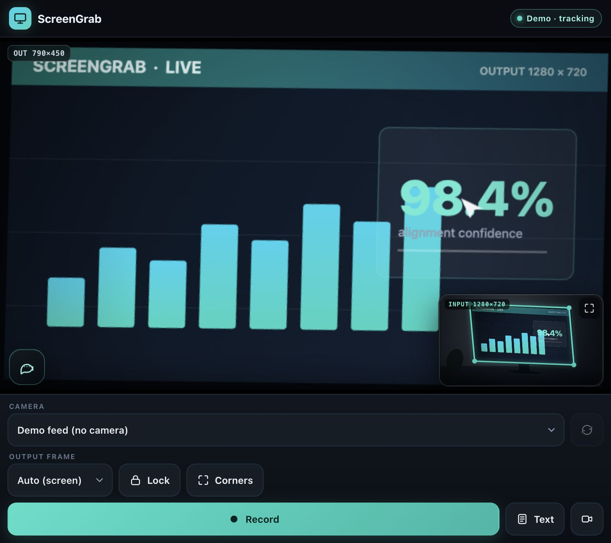
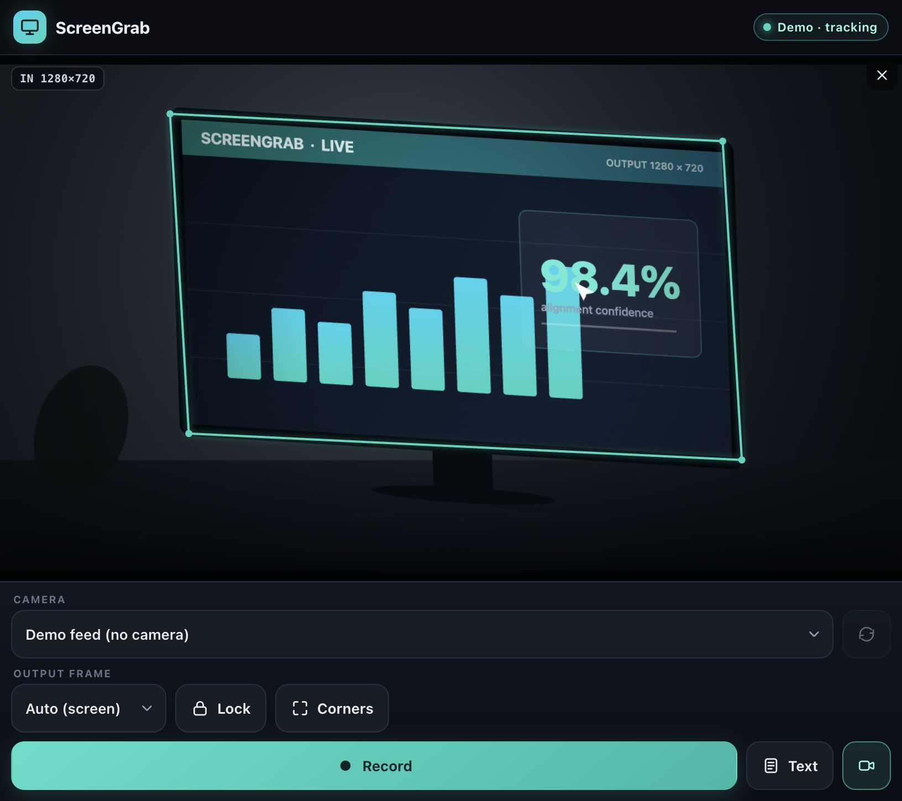
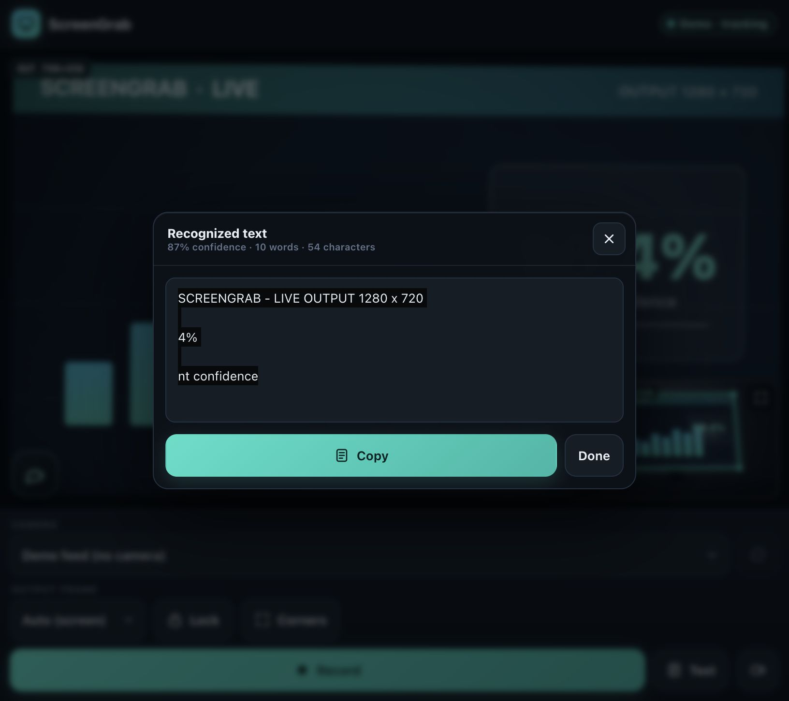
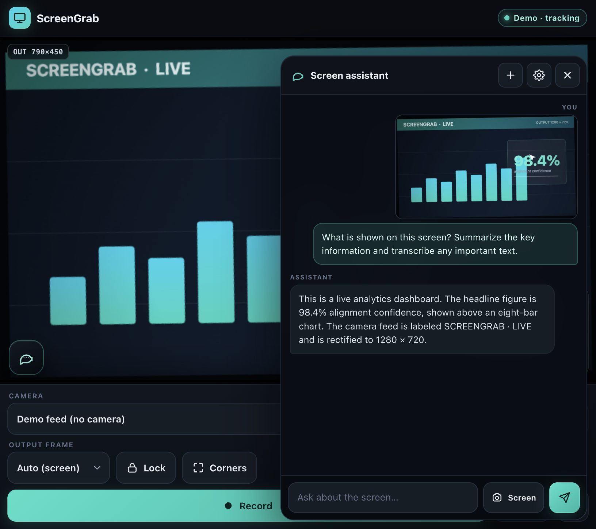

# ScreenGrab

**Point your phone at a monitor. Get a straight, cropped video feed of just the screen.**

ScreenGrab is a small, installable PWA that detects a screen in your camera feed,
finds its four corners, and perspective-corrects it into a clean, horizontally
and vertically aligned stream. The straightened output is the main view, with a
live camera preview in the corner for aiming — plus one-tap text copying via
OCR, recording, and an optional AI vision assistant.

<p align="center">
  
</p>

<p align="center">
  
  
  
  
  
  
</p>

- **Automatic screen detection** — edge detection and quad scoring, no manual setup.
- **Perspective rectification** — output is cropped to the screen and squared up.
- **Output-first layout** — the rectified feed fills the screen; the raw camera sits in a corner preview you can expand.
- **Phone first** — camera picker, rear camera by default, safe-area aware, landscape friendly.
- **Fixed aspect options** — 16:9, 4:3, 21:9, 9:16, 3:4, 1:1 with letterboxing, no stretching.
- **Record** — video straight from the rectified canvas, no server.
- **Copy text (OCR)** — read the screen and put its text on your clipboard.
- **AI screen assistant** — send the rectified frame to any OpenAI-compatible vision model.
- **Works offline** — service worker caches the app, the vision engine and the OCR engine.
- **Zero npm dependencies, zero build** — plain HTML, CSS and ES modules; the two engines load from a CDN on demand.

Video stays on your device. A screenshot is sent to an AI provider only when you
explicitly press **Screen** in the assistant.

---

## Try it without a camera

Append `?demo=1` to the URL (or choose **Demo feed (no camera)** in the camera
dropdown) to run the full pipeline on a synthetic animated monitor. Handy for
previews, screenshots and CI smoke tests.

```text
http://localhost:8144/?demo=1
```

## Quick start

Camera APIs require a secure context. `localhost` and `127.0.0.1` count as
secure, so a local server is enough:

```sh
python3 -m http.server 8144 --bind 127.0.0.1
```

Open <http://127.0.0.1:8144/> in your browser.

> Any static file server works. There is no package install, bundler or build
> step.

### Put it on your phone

Phones will not grant camera access over plain `http://192.168.x.x`, so serve
the folder over HTTPS.

**GitHub Pages** — push this folder to a repository, then go to
*Settings → Pages* and deploy from the branch root. The app uses relative URLs
throughout, so project sites (`/repo-name/`) work without changes.

**Netlify / Cloudflare Pages / Vercel** — drag the folder in, or point the
project at the repository. No build command, publish directory `.`.

**Temporary tunnel** — useful for testing on a real device:

```sh
cloudflared tunnel --url http://localhost:8144
```

Open the HTTPS URL on the phone, allow camera access, then use **Add to Home
Screen** / **Install** to run it standalone.

## Using it

| Control | What it does |
| --- | --- |
| **Camera** dropdown | Pick front, back or external camera. The choice is remembered. The flip button cycles cameras. |
| **Auto (screen)** | Default output frame: the rectified screen's own aspect ratio. |
| **16:9 / 4:3 / 21:9 / 9:16 / 3:4 / 1:1** | Fixed output frame. The screen is letterboxed inside it without stretching. |
| **Lock** | Stop tracking and keep the current corners. |
| **Corners** | Drag the four corners by hand, then press **Done**. |
| **Tap the camera preview** | In auto mode, tap any detected candidate to select and lock onto it. |
| **Input preview** | The raw camera feed sits in the bottom-right corner. Tap the expand icon — or the camera button in the controls — to view it full-screen. |
| **Text** | Copy the text on the screen to the clipboard using OCR. |
| **Record** | Record the rectified output (WebM, or MP4 where the browser supports it). |
| **Torch** | Shown when the active camera reports torch support. |
| **Chat bubble** | Open the AI screen assistant (bottom-left of the output). |

Detection runs about 11 times per second and the warp at up to 30 fps. Tracking
is smoothed and only dropped after the screen has been missing for ~1.6 s.

<p align="center">
  
</p>

## Copy text from the screen

Press **Text** in the main controls. ScreenGrab reads the current rectified frame
with [Tesseract.js](https://tesseract.js.org/), copies the result to the
clipboard, and offers a **Show** action in the toast. The text sheet lets you
review, edit and re-copy what was recognised.

- English (`eng`) traineddata, LSTM engine, automatic page segmentation.
- Frames smaller than 1600 px are upscaled and converted to grayscale first,
  which helps with small UI text.
- If the browser blocks clipboard access — iOS can require a fresh tap — the
  text sheet opens with a **Copy** button instead.
- The OCR engine (~10 MB) downloads on first use and is cached by the service
  worker, so later runs work offline.
- Accuracy depends on resolution, focus and contrast. Filling the frame with
  the screen and avoiding glare gives the best results.

<p align="center">
  
</p>

## AI screen assistant

The floating chat button opens **Screen assistant**. It works with any
OpenAI-compatible Chat Completions endpoint and a vision-capable model.

1. Open the assistant and fill in **Provider**, **API key**, **Model** and
   **API base URL**, then press **Save**.
2. Type a question, or press **Screen** to send the current rectified frame
   along with your question.
3. The answer appears in the chat. **+** starts a new chat; the gear reopens the
   model settings.

Presets cover **OpenAI** (`gpt-4o-mini`) and **OpenRouter**
(`openai/gpt-4o-mini`), plus **Custom / local** for Ollama, LM Studio, a
self-hosted proxy or any other compatible API.

<p align="center">
  
</p>

Settings and the API key live in this browser's `localStorage` — there is no
backend. Chat history stays in memory and is cleared with **+**. The endpoint
must allow browser CORS requests; if it does not, point the base URL at a small
proxy. The assistant needs a network connection; everything else works offline.

## Output API

The rectified canvas is exposed for automation or embedding:

```js
const stream = window.screenGrab.getStream();     // MediaStream, 30 fps
const canvas = window.screenGrab.canvas;          // HTMLCanvasElement
const blob   = await window.screenGrab.snapshot(); // PNG Blob (also downloads)
window.screenGrab.copyText();                     // OCR the frame and copy it
const state  = window.screenGrab.state;           // corners, mode, candidates, outW/outH…
```

## How it works

```text
camera ──┬─► input preview (corner or full-screen)
         │
         └─► detect: 640 px gray → blur → Canny → dilate → contours → quad
                     │
                     ▼
             corners + temporal smoothing
                     │
                     ▼
        warpPerspective ──► output canvas ──► main view · OCR · video · AI
```

- **Capture** — `getUserMedia` with `facingMode: environment` by default, ideal
  1920×1080 @ 30 fps, and a dropdown built from `enumerateDevices()`.
- **Detect** — each pass draws the video into a 640 px-wide grayscale canvas,
  runs Gaussian blur → Canny (mean-adaptive thresholds, plus a low-threshold
  retry) → dilate → contour finding. Quads come from `approxPolyDP` with a
  `minAreaRect`/convex-hull fallback. Candidates are scored by area,
  rectangularity, corner angles, aspect ratio and closeness to the previous
  frame.
- **Rectify** — `getPerspectiveTransform` + `warpPerspective` map the four
  corners onto a flat output canvas (long side capped at 1280 px). Only the
  screen's bounding box is read back from the video, so per-frame cost scales
  with the crop rather than the whole frame.
- **Stabilise** — exponential smoothing with hysteresis; a candidate is kept
  until it has been missing for 1.6 s.
- **OCR** — the rectified canvas is upscaled to at most 1600 px, converted to
  grayscale, and recognised with Tesseract.js (LSTM, PSM 3). The worker is
  created once and reused.
- **Assistant** — the chat panel captures the rectified canvas as a JPEG and
  sends it, with your question, to an OpenAI-compatible vision model over
  `fetch`.

The vision engine is [OpenCV.js 4.10.0](https://docs.opencv.org/4.10.0/opencv.js),
loaded on demand and cached by the service worker.

## Project structure

```text
index.html            markup, icon sprite, gate, output stage, input preview and text sheet
styles.css            mobile-first layout, safe areas, output/input/chat/OCR styling
js/app.js             camera lifecycle, UI, tracking loop, overlay, recording, OCR, AI chat
js/vision.js          OpenCV loader, Detector, Warper, geometry and scoring
js/ocr.js             lazy Tesseract.js loader, preprocessing and recognition
js/demo.js            synthetic monitor feed
manifest.webmanifest  PWA manifest
sw.js                 service worker (app shell + OpenCV/OCR caches)
icons/                generated PWA icons
docs/                 README screenshots
tools/make-icons.py   stdlib-only icon generator
```

Regenerate the icons with:

```sh
python3 tools/make-icons.py
```

## Offline / PWA

- `manifest.webmanifest` provides standalone display mode and any/maskable icons.
- `sw.js` precaches the app shell. Same-origin assets are served
  stale-while-revalidate; OpenCV.js and Tesseract.js assets are cache-first
  after the first download and live in a separate cache, so app updates do not
  re-download them.
- Bump `VERSION` in `sw.js` when shipping asset changes so old caches are
  replaced.

The first load needs a network connection for OpenCV (~10 MB). The first click
on **Text** needs it again for the OCR engine (~10 MB). After that the whole app
works offline.

## Browser support

- Camera access requires HTTPS (or `localhost`).
- **iOS Safari** supports the camera in the installed PWA on current iOS. If
  camera start fails there, open the URL in Safari; permission prompts are more
  reliable outside standalone mode.
- Torch support is Android/Chromium-only in practice.
- `MediaRecorder` produces WebM on Chromium/Firefox and MP4 where Safari
  supports it.
- Wake lock is requested while the camera is running, where supported.
- OCR runs locally in a Web Worker; the bundled model recognises English.
  Clipboard writes may need a fresh tap in Safari — the text sheet covers that.

## Debugging

Query flags, useful when testing detection:

| Flag | Effect |
| --- | --- |
| `?demo=1` | Synthetic animated monitor feed. |
| `?debug=1` | Log lifecycle and detection stages. |
| `?nodetect=1` | Skip detection. |
| `?nowarp=1` | Skip the perspective warp. |
| `?nooverlay=1` | Hide the detection overlay. |
| `?nocv=1` | Skip OpenCV loading. |
| `?nowake=1` | Skip the wake lock. |
| `?nodevices=1` | Skip device enumeration. |

## Notes

- Real-device testing matters: detection thresholds were tuned against a
  synthetic feed and typical monitor footage, but glare, extreme angles and
  very dark screens are always harder.
- OCR is best on crisp, high-contrast text; very small UI text may need a closer
  camera position or a fixed 16:9 frame that fills more of the output.
- The AI key is stored unencrypted in `localStorage`. Use a restricted key, and
  do not ship a shared key inside the app.

## License

No license has been added yet. Add a `LICENSE` file (MIT is a good default) if
you plan to share or distribute this.
